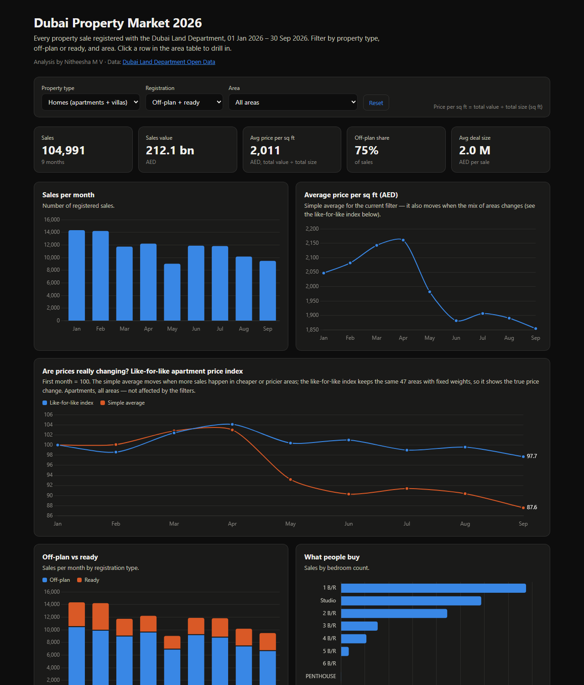
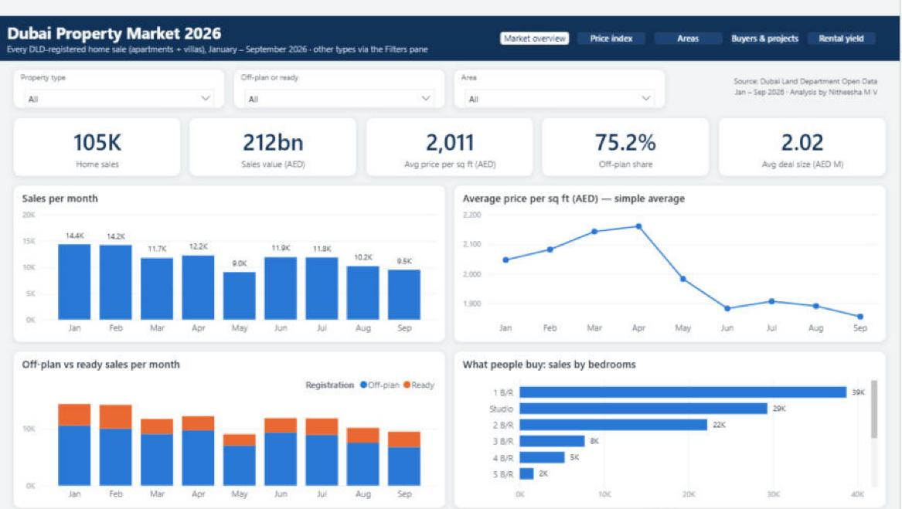
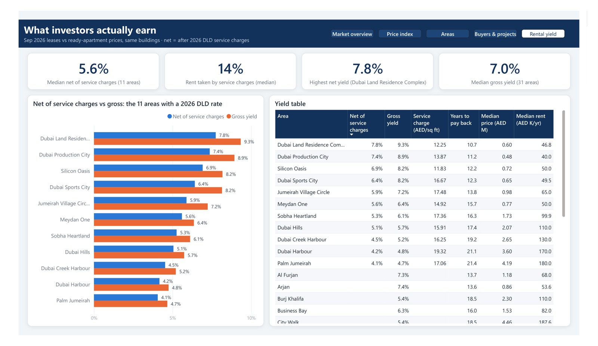

# Dubai Property Market 2026 — End-to-End Data Analysis

**Every property sale registered with the Dubai Land Department from 1 Jan to 30 Sep 2026 (121,741 transactions worth AED 376 bn), plus 25,988 new residential leases and 2026 RERA service charges for rental yield before and after costs.**
Cleaned in Python, modelled in SQL (DuckDB), explored in a Jupyter notebook, and delivered as an
interactive web dashboard and a Power BI report — with business recommendations.

**[▶ Live dashboard](https://nitheeshamv.github.io/Dubai-Real-Estate-Analysis/dashboard/)** ·
[Notebook](notebooks/dubai_real_estate_analysis.ipynb) ·
[Insights report](report/Insights_Report.md) ·
[Power BI guide](powerbi/BUILD_GUIDE.md)



### Power BI report




5 pages with built-in page navigation: market overview, like-for-like price index, areas, buyers & projects, and
"What investors actually earn" (rental yield before and after service charges).
Star schema (sales fact + date, area and property dimensions, plus price-index and rental-yield tables), 37 DAX measures,
custom navy theme, default "homes" filter.
[Download the .pbix](powerbi/Dubai_Real_Estate_2026.pbix) · [View as PDF](powerbi/Dubai_Real_Estate_2026.pdf) ·
the report is also stored as a text-based Power BI Project (`powerbi/Dubai_Real_Estate_2026.pbip`), generated by `src/06_build_pbip.py`.

## Business questions
1. How busy is Dubai's property market in 2026, and is it still growing?
2. How much of the market is off-plan, and what premium do buyers pay for it?
3. Are prices really falling — or is the average just moving with the mix of areas?
4. Which areas get the most demand, and which offer the best value per sq ft?
5. What do buyers buy (property type, bedrooms, budget)?
6. Where does an apartment investor earn the best rental yield — and what is left after service charges?

## Key findings
- **121,741 sales worth AED 376 bn.** Activity cooled: September had 11,038 sales, 36% fewer than January (partly seasonal — Ramadan, Eid and summer).
- **Off-plan dominates:** 75% of home sales were off-plan. Off-plan apartments cost **26% more per sq ft** than ready ones but only ~8% more per deal — buyers get smaller homes.
- **The "12% price drop" is mostly a mix effect.** A like-for-like index of 47 apartment areas (fixed basket) is down only **2.3%** since January (peak +4.1% in April). The simple average fell 12.4% because more sales happened in cheaper areas — it overstates the fall about 5×.
- **Demand is concentrated in affordable areas:** Madinat Al Mataar, Jumeirah Village Circle and Dubai Land Residence Complex take 24% of apartment sales; 10 of the 15 busiest areas are below the city median of AED 1,714 per sq ft.
- **Mid-market buyers:** 68% of homes sold for under AED 2M; 71% of apartments were studios or 1-bedrooms.
- **Cheaper areas pay back faster:** across 31 areas, the cheapest third earns a median **8.2%** gross rental yield vs **5.4%** for the priciest third (top: Dubai Investment Park Second 9.7%, Dubai Land Residence Complex 9.3%, International City Ph 1 9.1%; lowest: Palm Jumeirah 4.7%).
- **After service charges, cheaper areas still win — by less:** for the 11 areas with a 2026 DLD service-charge rate, the cheapest third nets **7.1%** vs **4.5%** for the priciest (the gap narrows from 3.3 to 2.6 points), because service charges take **17%** of rent in cheaper areas vs **13%** in prime ones. Top net: Dubai Land Residence Complex 7.8%; lowest: Palm Jumeirah 4.1%.

Recommendations for buyers, investors and brokers: **[Insights report](report/Insights_Report.md)**.

## How it works

```
DLD Open Data (CSV exports, 1-2 months each)
   │
   ▼
src/01_clean.py ──► data/clean/*.parquet ──► DuckDB tables `sales` + `rents`
   │                  dedupe · segment mapping · outlier rules · name normalising
   ▼
sql/*.sql ──► data/marts/*.csv        (CTEs, window functions, GROUPING SETS, fixed-basket price index)
   │
   ├──► notebooks/dubai_real_estate_analysis.ipynb   EDA, charts, findings
   ├──► src/04_insights.py ──► report/insights.json  every number in the findings is computed, not typed
   ├──► src/03_build_dashboard.py ──► dashboard/index.html   Chart.js, no server needed
   └──► src/05_powerbi_model.py ──► powerbi/model/*.csv      star schema for Power BI
```

| Layer | Tools | What it shows |
|---|---|---|
| Data cleaning | Python, pandas | Deduplication, data-quality rules, feature engineering (price per sq ft, segments, price bands) |
| Data modelling | SQL (DuckDB) | CTEs, `LAG`, `RANK`, `ROW_NUMBER`, `FILTER`, `GROUPING SETS`, `FIRST_VALUE` |
| Analysis | Jupyter, matplotlib | Trend, segmentation, like-for-like price index (mix effect), rental yield |
| Dashboard | HTML, JavaScript, Chart.js | Filterable KPIs, charts and drill-down tables |
| BI | Power BI, DAX | Star schema, time intelligence (`DATEADD`, `TOTALYTD`), `RANKX` |

## Data cleaning decisions
| Issue found in the raw export | Decision |
|---|---|
| Same sale repeated once per nearby metro station | One row per DLD transaction number |
| Buyer/seller counts always 0; master project >99% empty | Columns dropped |
| "Unit" mixes flats, offices, shops, hotel rooms | Mapped to Apartment / Villa / Commercial / Hotel / Land |
| Homes at < 100 or > 20,000 AED per sq ft (456 rows) | Dropped as data-entry errors (land kept) |
| Mixed casing of area names ("BUSINESS BAY" vs "Al Yelayiss 1") | Normalised |
| A single AED 3 bn plot deal topping the "projects" list | Projects need 10+ sales |
| Rents use official land-area names, sales use community names (only 10 areas joined) | Matched through building names, same buildings on both sides → 31 areas |
| Some leases are listed once under every building of a master community (one Creek Beach lease under all 12 towers) | Dropped (8,665 rows) — the real building is unknown |
| Service charges are only shown one project at a time behind a captcha (no bulk export) | 2026 rates looked up by hand for each area's most-rented building → `data/reference/service_charges_2026.csv` |
| Rent contracts for labour camps, staff housing, multi-unit leases | Kept single-unit flats, studios and villas only |

Row counts at every step: `data/clean/cleaning_log.csv` (122,551 raw rows → 121,741 clean).
Check: the January export has 17,364 rows, the same count DLD's own search shows.

## Run it yourself
1. Download the data: [DLD Open Data → Real Estate Data](https://dubailand.gov.ae/en/open-data/real-estate-data/) →
   **Transactions**, type **Sales**, 1–2 months per export → *Download as CSV* (larger ranges time out).
   For rental yield: the **Rents** tab, Version *New*, Usage *Residential*, one month → *Download as CSV*, saved with
   `rent` in the file name (this project uses September 2026). Without it `sql/06_rental_yield.sql` is skipped.
2. Put the CSVs in `data/raw/`.
3. Run:
   ```bash
   pip install -r requirements.txt
   python run_all.py
   ```
4. Open `dashboard/index.html` in a browser, or open the notebook.

## Repository structure
```
data/raw/        DLD CSV exports (not committed — see step 1)
data/reference/  hand-collected 2026 service charges (DLD Service Charge Index)
data/marts/      SQL outputs used by the dashboard and Power BI
sql/             analysis queries (01–07)
src/             pipeline scripts
notebooks/       analysis notebook
dashboard/       interactive dashboard (index.html) and its template
powerbi/         star-schema CSVs, DAX measures, build guide
report/          insights report and computed facts
docs/            interview walkthrough, screenshots
```

## Limitations
- DLD's open export covers the current year only, so year-on-year growth and seasonality are not measured.
- Some villa launches (e.g. Mareva at The Oasis, Eden Hills) are registered as land plots, so off-plan villa activity is understated.
- Area-level price changes can reflect a change in project mix inside the area (e.g. a luxury launch).
- Rental yields use one month of leases (September 2026). Net yields deduct service charges only (not vacancy,
  maintenance inside the unit or agency fees) and use one building's 2026 rate per area; 11 of the 31 areas have one so far.
- Next steps: service charges for the remaining areas, 2024–2025 data for year-on-year growth, a 6-month price forecast.

## About
Built by **Nitheesha M V**, Data Analyst · [LinkedIn](https://www.linkedin.com/in/nitheeshavishnupal) ·
Data: Dubai Land Department open data. Personal portfolio project — not investment advice.
